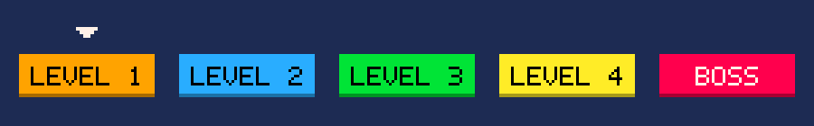

<div align="center">



### أساسيات تصميم وتطوير المواقع الإلكترونية


## [▶ افتح الموقع](https://qusaialbahri.github.io/WebCraftTraining/) · [▶ افتح محرر الأكواد](https://qusaialbahri.github.io/WebCraftTraining/editor/) · [⬇ تحميل الملفات](https://qusaialbahri.github.io/WebCraftTraining/WebCraft-files.zip) · [🎮 اختبر نفسك](https://qusaialbahri.github.io/WebCraftTraining/quiz/)

</div>

<div dir="rtl">

## 🕹️ عن التدريب

تدريب مدته يومان يمكّن الشباب من بناء أول موقع إلكتروني لهم: هيكل الصفحة بلغة HTML، والتنسيق بلغة CSS، والتصميم المتجاوب، والتفاعل بلغة JavaScript، مع مبادئ UI/UX والاستفادة من أدوات الذكاء الاصطناعي بمسؤولية.

## 📱 محرر الأكواد للهاتف

أغلب المشاركين يتدرّبون من هواتفهم، لذلك يضم المستودع محررًا يعمل من متصفح الهاتف مباشرة، بلا تطبيق ولا حساب:

| الميزة | ماذا تفعل |
| --- | --- |
| تبويبات HTML وCSS وJS | لكل لغة تبويب، والمعاينة بضغطة واحدة |
| شريط الرموز | أزرار للرموز الصعبة على لوحة الهاتف: `< > / { } ; " =` |
| الحفظ التلقائي | الكود يبقى على الهاتف حتى بعد إغلاق الصفحة |
| التمارين والحلول | بداية كل تمرين وحلّه وقالب المشروع النهائي في القائمة العلوية |
| لوحة الأخطاء | تعرض الخطأ ورقم السطر، بديلًا لأدوات المطوّر غير المتوفرة على الهاتف |
| الصور | رفع صورة من معرض الهاتف لتظهر مكان `images/...` |
| نسخ الصفحة كاملة | لإرسال العمل على واتساب أو نقله إلى VS Code |

## 🎮 اختبر نفسك

اختباران بأسلوب ألعاب 8 بت لمراجعة المادة: **WORLD 1** لليوم الأول (12 سؤالًا) و**WORLD 2** لليوم الثاني (14 سؤالًا)، مع قلوب ونقاط وشرح بعد كل سؤال ومراجعة للأخطاء في النهاية.

**[▶ ابدأ الاختبار](https://qusaialbahri.github.io/WebCraftTraining/quiz/)**

## 🖨️ قائمة الإنجازات للطباعة

ورقة A5 وجه وظهر: الوجه لليوم الأول والظهر لليوم الثاني. يضع الطالب ✓ بعد كل موضوع يتقنه، وفيها أهم الأكواد ورموز QR للمحرر والاختبار والمراجع.

**[⬇ تحميل قائمة الإنجازات (PDF · A5)](print/WebCraft-Checklist-A5.pdf)**

## 🗺️ خريطة المراحل



| المرحلة | المحتوى | المجلد |
| --- | --- | --- |
| LEVEL 1 · HTML | الصفحة التعريفية: header وnav وsection وform | [`01-tamreen1-start`](files/01-tamreen1-start) · [`02-tamreen1-solution`](files/02-tamreen1-solution) |
| LEVEL 2 · CSS | الألوان والخطوط وBox Model وFlexbox | [`03-tamreen2-solution`](files/03-tamreen2-solution) |
| LEVEL 3 · RESPONSIVE | viewport وMedia Queries ونهج الهاتف أولًا | [`04-tamreen3-solution`](files/04-tamreen3-solution) |
| LEVEL 4 · JAVASCRIPT | زر الوضع الليلي ورسالة الشكر | [`05-tamreen4-solution`](files/05-tamreen4-solution) |
| BOSS · FINAL PROJECT | قالب الموقع النهائي | [`06-final-project-template`](files/06-final-project-template) |

## 💾 هيكل المستودع

```
WebCraftTraining/
├── index.html            ← الصفحة الرئيسية
├── editor/index.html     ← محرر الأكواد للهاتف
├── quiz/index.html       ← اختبار اليوم الأول والثاني
├── print/                ← قائمة الإنجازات A5 للطباعة
├── files/                ← مجلد لكل تمرين: index.html و style.css و script.js و images/
└── WebCraft-files.zip    ← كل ملفات التمارين في ملف واحد
```

## 💻 على الحاسوب

حمّل الملفات، وافتح مجلد أي تمرين في VS Code، ثم شغّل `index.html` بإضافة Live Server.

</div>

<div align="center">


ابدأ صغيرًا، وابنِ كثيرًا، واستمر في التعلّم.

</div>
